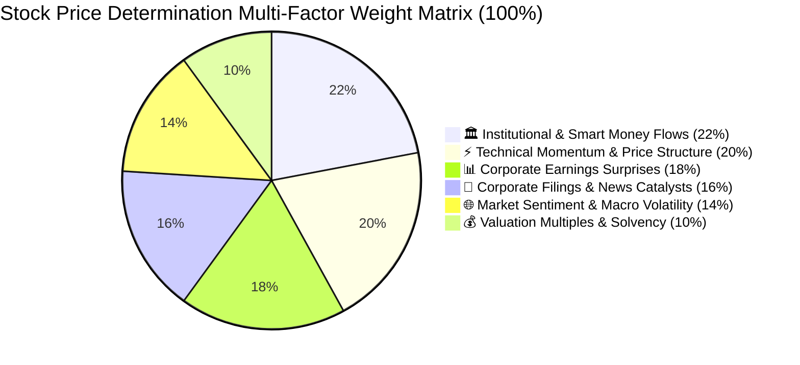

# Standardized Model Inputs, Factor Evaluation & Market Sentiment Hierarchy

> **Purpose**: Single authoritative specification of all quantitative, technical, fundamental, institutional, and sentiment inputs passed to all predictive models (DeepSeek-R1, Llama-3.3-70B, Qwen-2.5-72B, Mistral, Gemini, LightGBM, Kronos AI).
> **Total Factor Model Weight**: **100.0%** across 6 core pillars.
> **Implementation Engine**: [`earnings_engine/consensus/standard_inputs.py`](file:///d:/earnings-engine/earnings_engine/consensus/standard_inputs.py)

---

## 1. Master Factor Weight Hierarchy (100% Total)



| Pillar | Category Name | Total Weight | Core Driver |
| :--- | :--- | :---: | :--- |
| **Pillar 1** | **🏛️ Institutional & Smart Money Flows** | **22.0%** | Mutual fund (DII) QoQ accumulation, FII net flows, Whale investors, Block deals |
| **Pillar 2** | **⚡ Technical Momentum & Price Structure** | **20.0%** | Deliverable volume surge, 52W High resistance coiling, EMA stack alignment, RSI |
| **Pillar 3** | **📊 Corporate Earnings Surprises & Track Record** | **18.0%** | EPS surprise magnitude, Beat streaks, Post-earnings reaction drift (PEAD) |
| **Pillar 4** | **📰 Corporate Filings, Catalysts & News Sentiment** | **16.0%** | Multi-year order wins, FDA/regulatory approvals, CapEx expansion, JVs |
| **Pillar 5** | **🌐 Market Sentiment & Macro Volatility Regime** | **14.0%** | India VIX / CBOE VIX risk regime, Benchmark index momentum (Nifty 50 / S&P 500) |
| **Pillar 6** | **💰 Valuation Multiples & Balance Sheet Health** | **10.0%** | Relative P/E vs Sector P/E, Return on Equity (ROE), Debt-to-Equity solvency |

---

## 2. In-Depth Factor-by-Factor Review & Scope of Improvement

### Pillar 1: Institutional & Smart Money Flows (22.0%)
Institutions and mutual funds control the primary liquidity pools and determine long-term structural repricing.

| Sub-Factor | Weight | Relevance | Why It Matters (Quant Rationale) | Scope of Improvement |
| :--- | :---: | :---: | :--- | :--- |
| **Mutual Fund (DII) Net Stake Delta (QoQ)** | **7.0%** | `CRITICAL` | Domestic mutual funds manage sticky SIP capital. Consecutive quarter accumulation indicates institutional accumulation before retail discovery. | Ingest monthly fund factsheets / AMFI portfolio disclosures rather than waiting for quarterly SEBI filings. |
| **FII / FPI Institutional Inflows & Exits** | **6.0%** | `HIGH` | Foreign institutional flows dictate market-wide liquidity waves and large-cap multiple expansion. | Track FII sector-level allocation trends alongside single-stock filings. |
| **Super Investor & Whale Buying** | **4.5%** | `HIGH` | Proven track record of high-conviction alpha generation in mid/small-caps (Ashish Kacholia, Mukul Agrawal, Dolly Khanna). | Monitor BSE/NSE bulk disclosure timestamps to separate initial smart-money entry from late retail copycatting. |
| **Exchange Block / Bulk Deals Net Flow** | **4.5%** | `MEDIUM_HIGH` | Large transfers of equity without open-market slippage indicate institutional repositioning. | Filter promoter block sales (e.g. debt reduction vs stake dilution) from strategic fund entries. |

---

### Pillar 2: Technical Momentum & Price Structure (20.0%)
Price action reflects the real-time balance of aggressive market orders versus limit order liquidity.

| Sub-Factor | Weight | Relevance | Why It Matters (Quant Rationale) | Scope of Improvement |
| :--- | :---: | :---: | :--- | :--- |
| **Volume Surge Ratio (5D vs 63D / Deliverable Spike)** | **5.5%** | `CRITICAL` | Volume precedes price. A 2.5x–5.0x volume expansion validates true institutional absorption over retail churn. | Isolate deliverable volume percentage (Bhavcopy delivery %) from intraday scalping volume. |
| **52-Week High Resistance & Compression Coiling** | **5.0%** | `HIGH` | Equities trading within 0–5% of 52W Highs have zero overhead trapped supply, resulting in rapid expansion moves. | Compute rolling Bollinger Band Width (BBW) percentiles to mathematically quantify volatility compression. |
| **Moving Average Stack (EMA 20 > 50 > 200)** | **4.5%** | `HIGH` | Confirms multi-timeframe trend alignment and dynamic support floors during pullbacks. | Measure the slope velocity (rate of change) of the 20 EMA and 50 EMA. |
| **RSI-14 Momentum & Mean Reversion** | **3.0%** | `MEDIUM` | Differentiates strong momentum acceleration (55–70) from overbought exhaustion (> 78) and capitulation (< 30). | Pair with MACD histogram divergence to detect early momentum exhaustion before price pivots. |
| **Swing Range Channel Position** | **2.0%** | `MEDIUM` | Provides quantitative entry/exit boundaries (0% = channel support floor, 100% = channel resistance ceiling). | Dynamically expand swing channels based on 14-day ATR volatility bands. |

---

### Pillar 3: Corporate Earnings Surprises & Track Record (18.0%)
Quarterly financial results fundamentally re-rate discounted cash flow (DCF) expectations.

| Sub-Factor | Weight | Relevance | Why It Matters (Quant Rationale) | Scope of Improvement |
| :--- | :---: | :---: | :--- | :--- |
| **EPS & Revenue Surprise % (vs Consensus)** | **6.5%** | `CRITICAL` | Earnings surprise magnitude forces sell-side analysts to revise full-year forward EPS forecasts upward. | Distinguish core operating EBITDA beat from one-off non-operating income or tax adjustments. |
| **Historical Post-Earnings Reaction Returns (1D / 7D)** | **4.5%** | `HIGH` | Measures the Post-Earnings Announcement Drift (PEAD) persistence across recent corporate releases. | Calculate open-to-close drift vs overnight gap percentage. |
| **Surprise Streak & Beat Frequency** | **4.0%** | `MEDIUM_HIGH` | 3+ consecutive quarters of beats demonstrate management execution consistency and conservative guidance. | Incorporate management earnings call tone and transcript NLP sentiment scoring. |
| **Days to Next Earnings Announcement** | **3.0%** | `MEDIUM` | Implied volatility and options pricing expand significantly inside the 14-day pre-earnings window. | Integrate options implied move percentage for liquid derivatives (F&O) equities. |

---

### Pillar 4: Corporate Filings, Catalysts & News Sentiment (16.0%)
Idiosyncratic corporate developments alter forward growth trajectories independently of historical numbers.

| Sub-Factor | Weight | Relevance | Why It Matters (Quant Rationale) | Scope of Improvement |
| :--- | :---: | :---: | :--- | :--- |
| **Commercial Order Wins & Contract Awards** | **6.0%** | `CRITICAL` | Substantial order inflows directly provide multi-year revenue visibility and margin expansion. | Normalize order value as a percentage of the company's trailing 12-month revenue (TTM). |
| **Regulatory Clearances & FDA Approvals** | **4.0%** | `HIGH` | Removes binary regulatory overhangs and enables high-margin commercialization (especially in Pharma/CDMO). | Track regulatory inspection resolution speed (e.g. FDA EIR / 483 closure). |
| **CapEx Expansion & Joint Ventures** | **3.5%** | `MEDIUM_HIGH` | Demonstrates management capital allocation conviction to capture structural industry tailwinds. | Assess past Return on Capital Employed (ROCE) generation during prior CapEx execution cycles. |
| **Management Guidance & Restructuring** | **2.5%** | `MEDIUM` | Upgraded management guidance serves as the catalyst for institutional rating upgrades. | Cross-reference guidance against management's historical track record of beating vs missing targets. |

---

### Pillar 5: Market Sentiment & Macro Volatility Regime (14.0%)
Broad market tides dictate whether individual stock setups succeed or experience macro drag.

| Sub-Factor | Weight | Relevance | Why It Matters (Quant Rationale) | Scope of Improvement |
| :--- | :---: | :---: | :--- | :--- |
| **India VIX / CBOE VIX Volatility Regime** | **5.0%** | `CRITICAL` | VIX < 14 provides calm trending tailwinds; VIX > 20 indicates systemic market risk and failed technical breakouts. | Track 5-day rate of change in VIX to detect volatility spikes before index breakdowns. |
| **Benchmark Index Trend (Nifty 50 / S&P 500)** | **4.5%** | `HIGH` | Over 70% of individual equities move in the direction of the broader benchmark index. | Integrate the Advance-Decline Ratio (market breadth) across the broad NSE 500 universe. |
| **Sector Relative Strength Index (RS vs Nifty)** | **4.5%** | `HIGH` | Leading stocks in outperforming sectors experience institutional sector-rotation inflows. | Compute rolling 21-day Mansfield Relative Strength (MRS) against the benchmark index. |

---

### Pillar 6: Valuation Multiples & Balance Sheet Health (10.0%)
Fundamental quality and solvency protect capital against downside multiple compression during market corrections.

| Sub-Factor | Weight | Relevance | Why It Matters (Quant Rationale) | Scope of Improvement |
| :--- | :---: | :---: | :--- | :--- |
| **Relative P/E Multiple vs Sector Benchmark P/E** | **3.5%** | `HIGH` | Establishes margin of safety and identifies whether the equity is trading at an unjustified discount or dangerous bubble. | Use Forward 1-Year P/E (PEG ratio) rather than Trailing P/E where consensus estimates exist. |
| **Return on Equity (ROE) & Operating Margins** | **3.5%** | `HIGH` | High ROE (> 18%) with strong operating margins (> 15%) proves pricing power and competitive economic moats. | Deconstruct ROE using 3-stage DuPont Analysis (Net Margin × Asset Turnover × Financial Leverage). |
| **Debt-to-Equity (D/E) Ratio & Solvency** | **3.0%** | `MEDIUM_HIGH` | Low leverage (D/E < 0.5) eliminates bankruptcy risk and ensures resilience during high interest rate regimes. | Track Interest Coverage Ratio (EBIT / Interest Expense) for capital-intensive sectors. |

---

## 3. Real-Time Market Sentiment & Volatility Regime Mapping

Market sentiment is classified into 4 standardized volatility regimes:

```
[VIX < 13.0]  ➔ 🟢 LOW_RISK_BULLISH   (Full risk-on; momentum breakouts have high follow-through)
[13.0 - 17.0] ➔ 🔵 STABLE_NORMAL      (Standard balanced market; normal position sizing)
[17.0 - 22.0] ➔ 🟡 ELEVATED_CHOP      (Heightened macro volatility; tighter trailing stop losses required)
[VIX > 22.0]  ➔ 🔴 HIGH_RISK_PANIC    (Extreme risk-off; defensive positioning; cash preservation)
```

The composite Market Sentiment Score (0–100) dynamically modulates the conviction thresholds in all downstream AI consensus prompts:
- **Score ≥ 70**: `🟢 Strong Bullish Market Tailwind`
- **Score 55–69**: `🔵 Supportive / Stable Market`
- **Score 40–54**: `🟡 Mixed / Volatile Market Conditions`
- **Score < 40**: `🔴 Strong Macro Headwind / Risk-Off`
